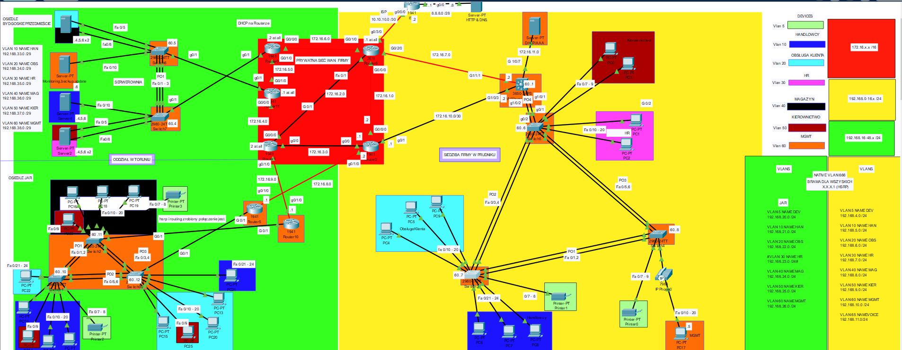

# Projekt Sieci Korporacyjnej (Prudnik - Toruń)

## O projekcie
Stworzyłem projekt sieci dla firmy z dwoma głównymi oddziałami: siedzibą główną w Prudniku oraz oddziałem w Toruniu, który dzieli się na dwie lokalizacje (pododdziały): Osiedle Bydgoskie Przedmieście oraz Osiedle JAR. 

- Toruń (Bydgoskie Przedmieście): Zlokalizowana jest tutaj główna serwerownia obsługująca wszystkie działy w sieci (HR, Obsługa Klienta, Handlowcy, Magazyn, Kierownictwo, MGMT). 
- Toruń (Osiedle JAR): Obszar pracy konkretnych działów klienckich.
- Prudnik (Siedziba Główna): Mieści się tu serce pracy działów oraz centrum zarządzania siecią (stacja Admina). Zastosowałem tu celowy zabieg architektoniczny – znajduje się tu odseparowany serwer AAA (TACACS+) obsługujący całą sieć oraz serwer DHCP, który przydziela adresację dla pododdziału JAR w Toruniu oraz dla samej siedziby w Prudniku. Z kolei w serwerowni na Bydgoskim Przedmieściu rolę serwera DHCP pełnią lokalne routery brzegowe (pracujące w układzie HSRP), aby w razie awarii w strefie WAN tamtejsze zasoby nie straciły adresacji i łączności.

### Redundancja i Routing
Całą sieć zabezpieczyłem przed awariami pojedynczych ogniw – wyjścia ze stref LAN do WAN są zrealizowane na co najmniej dwóch połączeniach. Wysoką dostępność zapewniają protokoły HSRP, LACP (EtherChannel) oraz topologia częściowej siatki (Partial Mesh) w prywatnej strefie WAN. Komunikację wewnątrz firmy obsługuje jednoobszarowy OSPF, natomiast wyjście na świat realizuje statyczna trasa domyślna połączona z PAT (NAT z przeciążeniem) na styku sieci z internetem.

## Zaimplementowane technologie i funkcjonalności

- Routing & Switching: OSPF (Single-Area), Static Default Route, Router-on-a-Stick, Inter-VLAN Routing, VLANs (Data & Voice VLAN).
- Wysoka dostępność (HA): HSRP, LACP (EtherChannel), redundantne łącza WAN (Partial Mesh).
- Usługi sieciowe: DHCP (centralny serwer + lokalny router + ip helper-address), DNS, HTTP, NTP, Syslog, PAT (NAT Overload).
- Zarządzanie i dokumentacja: Scentralizowane AAA (TACACS+), dostęp zdalny wyłącznie przez SSHv2 (wyłączony Telnet), szyfrowanie haseł w konfiguracji (service password-encryption), limity czasu bezczynności (exec-timeout), banery ostrzegawcze (banner motd), dokładne opisy (description) na wszystkich interfejsach oraz kontrola protokołów odkrywania sąsiadów (wyłączone CDP, włączone LLDP z blokadą no lldp transmit w stronę hostów).

(Uwaga: Świadomie pominąłem w tym projekcie konfigurację DHCP Snooping oraz Dynamic ARP Inspection – ze względu na specyfikę i znane ograniczenia symulatora Packet Tracer funkcje te potrafią powodować niestabilność i błędy przy tak złożonej topologii).

## Bezpieczeństwo i logika izolacji (ACL / Hardening)

Moim głównym celem była bezwzględna separacja pomiędzy niezależnymi od siebie działami (VLAN-ami) oraz zabezpieczenie infrastruktury przed celowymi lub przypadkowymi błędami użytkowników:

- Zaawansowane Listy Kontroli Dostępu (ACL) i logika biznesowa: Ruch między VLAN-ami został ograniczony do niezbędnego minimum. Przykładowo: VLAN 10 (Handlowcy) na osiedlu JAR ma dostęp tylko do odpowiadającego mu VLAN-u 10 w Prudniku oraz w serwerowni. 
- Wyróżnienie dla VLAN 5 (Devices / Drukarki): Ponieważ z drukarek muszą korzystać wszyscy pracownicy, wpuściłem ich ruch do każdego VLAN-u roboczego, ale „bez butów” – za pomocą ACL ograniczyłem komunikację tak, że drukarki mogą jedynie odpowiadać na ruch zainicjowany przez hosty, ale same nie mogą zainicjować połączenia.
- Strefa Zarządzania (VLAN 60 MGMT): W serwerowni serwer MGMT (VLAN 60) ma dostęp do pozostałych VLAN-ów serwerowych w celu przeprowadzania aktualizacji. Z kolei w Prudniku stacja robocza Admina (VLAN 60, podpięta przelotowo przez IP Phone z obsługą Voice VLAN) ma jako jedyna pełny dostęp przez SSH do wszystkich urządzeń sieciowych oraz uprawnienia do wprowadzania zmian z poziomu serwera MGMT na pozostałe serwery (VLAN 10, 20, 30, 40, 50).
- Centralne uwierzytelnianie (TACACS+): Logowanie do urządzeń spięte z serwerem AAA, ze skonfigurowanym awaryjnym kontem w lokalnej bazie danych (local fallback) na wypadek utraty łączności z serwerem.
- Bezpieczeństwo warstwy 2 (L2 Security):
  - Port Security: Przypisanie maksymalnie jednego adresu MAC na interfejs przełącznika.
  - PortFast + BPDU Guard: Natychmiastowe podnoszenie portów dostępowych z automatycznym blokowaniem portu w razie wykrycia ramek BPDU (ochrona przed podpięciem obcego switcha).
  - Blackhole VLAN & Native VLAN: Wszystkie nieużywane porty zostały przełączone w tryb access, przypisane do nieużywanego VLAN-u Blackhole i administracyjnie wyłączone (shutdown). Domyślny Native VLAN na trunkach został zmieniony na nieużywany ID.
  - Wyłączenie DTP (switchport nonegotiate): Blokada automatycznej negocjacji trunków.
- OSPF Passive-Interface: Wyłączenie rozgłaszania pakietów Hello i nawiązywania sąsiedztwa OSPF na interfejsach skierowanych w stronę sieci LAN.
- Ochrona informacji o topologii i utwardzanie dostępu: Globalne wyłączenie protokołu CDP i zastąpienie go standardem LLDP z wyłączonym nadawaniem (no lldp transmit) na portach końcowych. Dostęp do urządzeń zabezpieczony protokołem SSH w wersji 2, szyfrowaniem haseł oraz automatycznym wylogowaniem po bezczynności (exec-timeout).

## Dane logowania do urządzeń (Do testów)

Aby ułatwić weryfikację konfiguracji wewnątrz projektu, poniżej znajdują się poświadczenia do wszystkich urządzeń:

- Logowanie AAA (TACACS+) / SSH / Console:
  - Username: admin
  - Password: test1234!
- Hasło do trybu uprzywilejowanego (Enable): cisco
- Konto awaryjne (gdyby serwer TACACS+ był nieosiągalny):
  - Username: Cisco
  - Password: CiscoP
